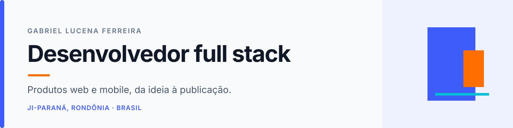

  

  
  
  

  <b>Full Stack Developer</b> &nbsp;·&nbsp; Web & Mobile &nbsp;·&nbsp; Software sob medida

---

## Oi, eu sou o Gabriel 👋

Gosto de tirar produtos digitais do papel: da interface e das APIs até banco de dados, integrações e publicação. Hoje desenvolvo a **Federada**, plataforma de gestão esportiva em produção, e atuo na **[IAD TECH](https://iadtech.com.br/)** criando soluções digitais para negócios.

> Sistemas web, apps, e-commerces, landing pages e automações — desenvolvidos sob medida.

🎓 **ADS no IFRO** · conclusão prevista em 12/2026 &nbsp;&nbsp; 💼 **Técnico de Suporte Sênior** · TRE-RO / Get Info 
📍 Ji-Paraná, Rondônia &nbsp;&nbsp; 🌎 Português · Inglês intermediário · Espanhol básico

## Projetos que estou construindo

<table>
  <tr>
    <td width="50%" valign="top">
      <h3>🏆 Federada</h3>
      
Plataforma em produção para gestão de atléticas e competições: equipes, inscrições, partidas, documentos, pagamentos e administração.

      
<b>Do produto ao deploy</b> Desenvolvimento full stack independente, incluindo modelagem, integrações e operação.

      
React · TypeScript · NestJS · PostgreSQL · Docker

    </td>
    <td width="50%" valign="top">
      <h3>📱 ApprovaJÁ</h3>
      
App de financiamento automotivo com simulação, contratação e painel administrativo, além de integração com APIs e Firebase.

      
<b>Experiência mobile ponta a ponta</b> Participei do ciclo de builds e publicação para iOS e Android.

      
React Native · TypeScript · NestJS · MySQL · Firebase

    </td>
  </tr>
</table>

<a href="https://iadtech.com.br/#portfolio"><b>Explorar projetos da IAD TECH →</b></a>

## Meu kit de trabalho

**Web & backend** 

**Mobile & lançamento** 

Builds e publicação de aplicativos para iOS e Android, incluindo o ciclo de lançamento nas lojas.

**Dados & ferramentas** 

Também tenho experiência com APIs REST, PHP/Scriptcase, Robot Framework e testes de software.

## Experiência

| Período | Empresa | Atuação |
|---|---|---|
| 2026 – atual | **TRE-RO / Get Info Soluções** | Técnico de Suporte Sênior |
| 2025 – 2026 | **IFRO – Proinfe** | Desenvolvimento web, QA e suporte a sistema de gestão escolar |
| 2025 | **Compass UOL** | QA, automação de testes, APIs REST e apoio a AWS |
| 2024 – 2025 | **CEPLAC / MAPA** | Desenvolvimento de módulos do BAGCACAU |
| 2024 | **Wadt Engenharia e TI** | Análise, desenvolvimento e manutenção de sistemas |

## Formação & aprendizado contínuo

- **Análise e Desenvolvimento de Sistemas** — IFRO · conclusão prevista: 12/2026
- **Técnico em Informática** — IFRO · 2022
- **CS50 — Introdução à Ciência da Computação** — Harvard University · 70h · 2023
- **NLW Unite — ReactJS** — Rocketseat · 2024
- **Desenvolvimento Android** — Novos Negócios em TIC · 300h · 2024
- **Campus Party Brasil CPBR15** — 700h de imersão · 2023
- Oficinas IFRO: NestJS, Node.js, React, Docker e Git/GitHub · 2022

## Um pouco do GitHub

  
  

Valeu por passar por aqui — fique à vontade para explorar meus projetos ou falar comigo.

